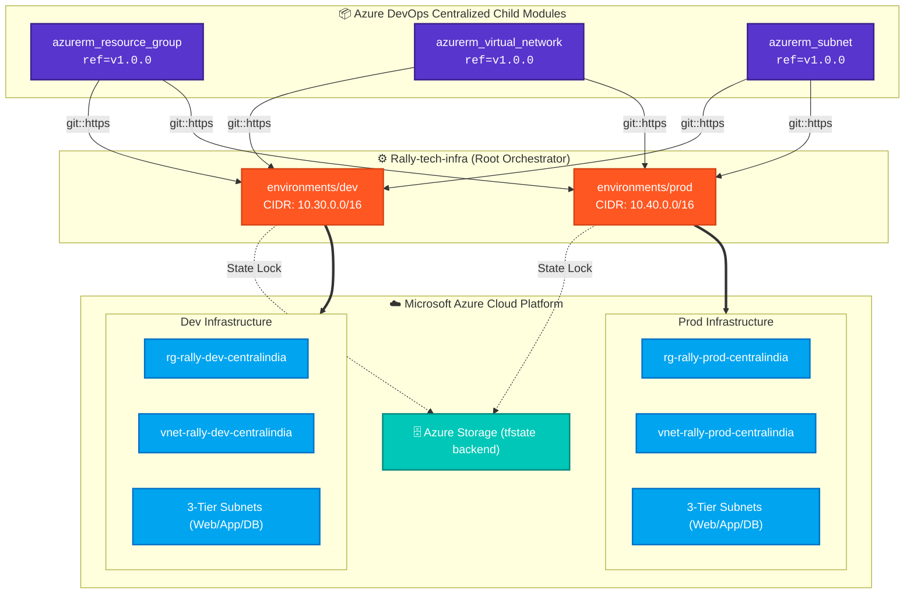

<div align="center">

<!-- HEADER BANNER -->


<br/>

<!-- ANIMATED TYPING BANNER -->
<a href="https://dev.azure.com/satyam-cicd-org/DevOpsOrbit/_git/Rally-tech-infra">
  
</a>

<br/>

<!-- TECH BADGES -->
<p align="center">
  
  
  
  
  
</p>

<!-- NAVIGATION BAR -->
<p align="center">
  <b><a href="#-executive-summary">Executive Summary</a></b> •
  <b><a href="#-architecture--topology">Architecture</a></b> •
  <b><a href="#-core-modules-catalog">Core Modules</a></b> •
  <b><a href="#-environments-matrix">Environments</a></b> •
  <b><a href="#-remote-backend">State Backend</a></b> •
  <b><a href="#-deployment-workflow">Quickstart</a></b>
</p>

</div>

---

## ⚡ Executive Summary

The **Rally Tech Infrastructure** is an enterprise-grade Infrastructure as Code (IaC) orchestrator engineered for scalability, high availability, and multi-tenant isolation. It consumes versioned, centralized child modules hosted in Azure DevOps, ensuring zero-drift and reproducible cloud environments across **Development (`dev`)** and **Production (`prod`)**.

### 🌟 Enterprise Highlights

<table>
  <tr>
    <td width="50%" valign="top">
      <h4>📦 100% Modular Child Architecture</h4>
      <p>Uses micro-module design. Resource Groups, Virtual Networks, and Subnets are decoupled and sourced dynamically from dedicated Azure DevOps Git repos with semantic versioning (<code>?ref=v1.0.0</code>).</p>
    </td>
    <td width="50%" valign="top">
      <h4>🛡️ Multi-Environment Blast Radius Isolation</h4>
      <p>Strict logical and network segregation between <code>dev</code> (<code>10.30.0.0/16</code>) and <code>prod</code> (<code>10.40.0.0/16</code>) with independent state storage containers.</p>
    </td>
  </tr>
  <tr>
    <td width="50%" valign="top">
      <h4>🔒 Automated State Management & Locking</h4>
      <p>Centralized remote state tracking via Azure Blob Storage backend with native blob leasing to prevent race conditions during concurrent CI/CD pipeline runs.</p>
    </td>
    <td width="50%" valign="top">
      <h4>🚀 3-Tier Enterprise Networking</h4>
      <p>Pre-configured segmented subnets for <b>Frontend</b> (Web), <b>Backend</b> (App/API), and <b>Database</b> tiers with zero inter-tier leakage.</p>
    </td>
  </tr>
</table>

---

## 🏛️ Architecture & Topology



---

## 📂 Repository Topology

```text
Rally-tech-infra/
│
├── environments/
│   ├── dev/                          # Development Environment Root
│   │   ├── main.tf                   # Orchestrates Azure DevOps child modules
│   │   ├── provider.tf               # azurerm provider + dev backend block
│   │   ├── variable.tf               # Input variable schemas
│   │   ├── terraform.tfvars          # Dev environment parameter values
│   │   └── outputs.tf                # Dev exported outputs
│   │
│   ├── test/                         # Test/QA Environment Root
│   │   ├── main.tf                   # Orchestrates Azure DevOps & GitHub child modules
│   │   ├── provider.tf               # azurerm provider + test backend block
│   │   ├── variable.tf               # Input variable schemas
│   │   ├── terraform.tfvars          # Test environment parameter values
│   │   └── outputs.tf                # Test exported outputs
│   │
│   └── prod/                         # Production Environment Root
│       ├── main.tf                   # Orchestrates Azure DevOps child modules
│       ├── provider.tf               # azurerm provider + prod backend block
│       ├── variable.tf               # Input variable schemas
│       ├── terraform.tfvars          # Prod environment parameter values
│       └── outputs.tf                # Prod exported outputs
│
├── .gitignore                        # Terraform cache & lock ignores
└── README.md                         # Enterprise documentation
```

---

## 📦 Core Modules Catalog

| Module | Source Repository | Semantic Tag | Role |
| :--- | :--- | :---: | :--- |
| **`azurerm_resource_group`** | `.../DevOpsOrbit/_git/azurerm_resource_group` | `v1.0.0` | Manages lifecycle, metadata, and enterprise tags |
| **`azurerm_virtual_network`** | `.../DevOpsOrbit/_git/azurerm_virtual_network` | `v1.0.0` | Provisions VNets, custom CIDRs & DNS settings |
| **`azurerm_subnet`** | `.../DevOpsOrbit/_git/azurerm_subnet` | `v1.0.0` | Configures micro-segmented subnets per tier |

<details>
<summary><b>🔍 View Module Orchestration Implementation (<code>main.tf</code>)</b></summary>

```hcl
module "resource_group" {
  source = "git::https://satyam-cicd-org@dev.azure.com/satyam-cicd-org/DevOpsOrbit/_git/azurerm_resource_group?ref=v1.0.0"

  resource_groups = var.resource_groups
}

module "virtual_network" {
  source = "git::https://satyam-cicd-org@dev.azure.com/satyam-cicd-org/DevOpsOrbit/_git/azurerm_virtual_network?ref=v1.0.0"

  virtual_networks = var.virtual_networks
  depends_on       = [module.resource_group]
}

module "subnet" {
  source = "git::https://satyam-cicd-org@dev.azure.com/satyam-cicd-org/DevOpsOrbit/_git/azurerm_subnet?ref=v1.0.0"

  subnets    = var.subnets
  depends_on = [module.virtual_network]
}
```
</details>

---

## 🌐 Environments Matrix

| Specification | Development (`dev`) | Test (`test`) | Production (`prod`) | Status |
| :--- | :--- | :--- | :--- | :---: |
| **Azure Region** | `centralindia` | `centralindia` | `centralindia` | Active |
| **Resource Group** | `rg-rally-dev-centralindia` | `rg-rally-test-centralindia` | `rg-rally-prod-centralindia` | Provisioned |
| **Virtual Network** | `vnet-rally-dev-centralindia` | `vnet-rally-test-centralindia` | `vnet-rally-prod-centralindia` | Provisioned |
| **VNet Address Space** | `10.30.0.0/16` | `10.20.0.0/16` | `10.40.0.0/16` | Isolated |
| **Frontend Tier (`snet-frontend`)** | `10.30.1.0/24` | `10.20.1.0/24` | `10.40.1.0/24` | Ready |
| **Backend Tier (`snet-backend`)** | `10.30.2.0/24` | `10.20.2.0/24` | `10.40.2.0/24` | Ready |
| **Database Tier (`snet-database`)** | `10.30.3.0/24` | `10.20.3.0/24` | `10.40.3.0/24` | Ready |

---

## 🔒 Remote Backend

State persistence is configured via Azure Storage Backend with encryption-at-rest and blob lease concurrency control:

```hcl
backend "azurerm" {
  resource_group_name  = "a-git"
  storage_account_name = "storagecicdpipline1"
  container_name       = "tfstate"
  key                  = "dev.terraform.tfstate"
}
```

---

## 🚀 Deployment Workflow

<details open>
<summary><b>🛠️ Step-by-Step CLI Execution</b></summary>

```bash
# 1. Login to Azure
az login --tenant <TENANT_ID>
az account set --subscription <SUBSCRIPTION_ID>

# 2. Switch to target environment
cd environments/dev    # or environments/prod

# 3. Initialize Terraform & pull Azure DevOps child modules
terraform init

# 4. Validate formatting & syntax
terraform validate

# 5. Generate and inspect execution plan
terraform plan -out=tfplan.binary

# 6. Apply approved changes
terraform apply tfplan.binary
```
</details>

---

<div align="center">


<sub>Built with ❤️ by <b>DevOpsOrbit Platform Engineering Team</b> • Powered by Azure DevOps & Terraform</sub>

</div>
