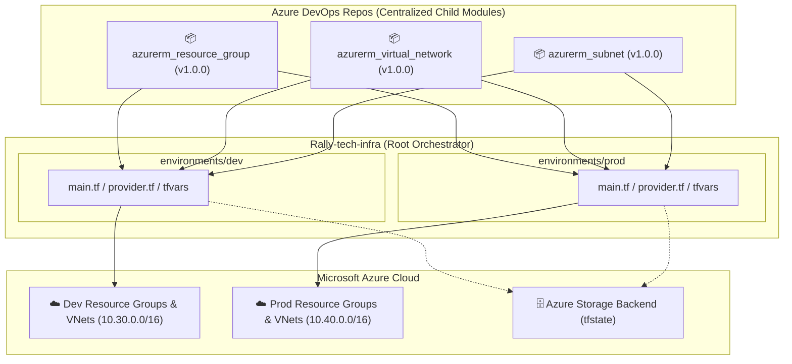

# 🚀 Rally Tech Infrastructure (`Rally-tech-infra`)

[](https://www.terraform.io/)
[](https://azure.microsoft.com/)
[](https://dev.azure.com/)
[](https://dev.azure.com/satyam-cicd-org/DevOpsOrbit/_git/Rally-tech-infra)

Enterprise-grade Infrastructure as Code (IaC) repository for **Rally Tech**, provisioned and maintained using Terraform on Microsoft Azure with modular architecture sourced directly from centralized Azure DevOps Git repositories.

---

## 🏛️ Architecture Overview

This repository acts as the **Root Module / Orchestrator** for the Rally Tech cloud infrastructure. It provisions core networking and compute boundary foundations across isolated multi-tier environments (`dev` and `prod`) by consuming version-pinned child modules hosted in Azure DevOps.



---

## 📂 Repository Structure

```text
Rally-tech-infra/
├── environments/
│   ├── dev/
│   │   ├── main.tf             # Module orchestration referencing Azure DevOps Git modules
│   │   ├── provider.tf         # AzureRM provider & backend configuration
│   │   ├── variable.tf         # Input variable schema definitions
│   │   ├── terraform.tfvars    # Environment-specific configuration for Development
│   │   └── outputs.tf          # Exported resource details (IDs, names, address spaces)
│   └── prod/
│       ├── main.tf             # Module orchestration referencing Azure DevOps Git modules
│       ├── provider.tf         # AzureRM provider & backend configuration
│       ├── variable.tf         # Input variable schema definitions
│       ├── terraform.tfvars    # Environment-specific configuration for Production
│       └── outputs.tf          # Exported resource details
├── .gitignore                  # Terraform cache and state exclusion rules
└── README.md                   # Enterprise documentation
```

---

## 📦 Upstream Child Modules Catalog

All infrastructure resources are created via reusable, standardized child modules pinned by Git release tags:

| Module | Source Azure DevOps Repository | Tag | Responsibilities |
| :--- | :--- | :--- | :--- |
| **Resource Group** | `.../DevOpsOrbit/_git/azurerm_resource_group` | `v1.0.0` | Creates lifecycle-managed resource groups with enterprise tags |
| **Virtual Network** | `.../DevOpsOrbit/_git/azurerm_virtual_network` | `v1.0.0` | Provisions VNets, custom CIDRs, and DNS settings |
| **Subnets** | `.../DevOpsOrbit/_git/azurerm_subnet` | `v1.0.0` | Multi-tier segmentation (frontend, backend, database) |

### Module Invocation Pattern (`main.tf`):
```hcl
module "resource_group" {
  source = "git::https://satyam-cicd-org@dev.azure.com/satyam-cicd-org/DevOpsOrbit/_git/azurerm_resource_group?ref=v1.0.0"

  resource_groups = var.resource_groups
}

module "virtual_network" {
  source = "git::https://satyam-cicd-org@dev.azure.com/satyam-cicd-org/DevOpsOrbit/_git/azurerm_virtual_network?ref=v1.0.0"

  virtual_networks = var.virtual_networks
  depends_on       = [module.resource_group]
}

module "subnet" {
  source = "git::https://satyam-cicd-org@dev.azure.com/satyam-cicd-org/DevOpsOrbit/_git/azurerm_subnet?ref=v1.0.0"

  subnets    = var.subnets
  depends_on = [module.virtual_network]
}
```

---

## 🌐 Environment Specifications

| Parameter | Development (`dev`) | Production (`prod`) |
| :--- | :--- | :--- |
| **Resource Group** | `rg-rally-dev-centralindia` | `rg-rally-prod-centralindia` |
| **Location** | `centralindia` | `centralindia` |
| **VNet Name** | `vnet-rally-dev-centralindia` | `vnet-rally-prod-centralindia` |
| **Address Space** | `10.30.0.0/16` | `10.40.0.0/16` |
| **Frontend Subnet** | `10.30.1.0/24` | `10.40.1.0/24` |
| **Backend Subnet** | `10.30.2.0/24` | `10.40.2.0/24` |
| **Database Subnet** | `10.30.3.0/24` | `10.40.3.0/24` |

---

## 🔒 Remote Backend (State Management)

State files are secured and centrally stored in Azure Blob Storage with automated lease locking:

* **Resource Group:** `rg-terraform-state-dev` / `rg-terraform-state-prod`
* **Storage Account:** `strorallydevtfstate` / `strorallyprodtfstate`
* **Blob Container:** `tfstate`
* **State Key:** `rally-tech-infra.{env}.terraform.tfstate`

---

## 🚀 Deployment Guide

### Prerequisites
* [Terraform CLI](https://developer.hashicorp.com/terraform/downloads) `>= 1.3.0`
* [Azure CLI](https://learn.microsoft.com/en-us/cli/azure/install-azure-cli) `>= 2.40.0`
* Access permissions to Azure subscription & Azure DevOps repositories.

### Quick Start (e.g. `dev` environment):
```powershell
# 1. Authenticate with Azure
az login

# 2. Navigate to target environment
cd environments/dev

# 3. Initialize working directory & download remote child modules
terraform init

# 4. Validate configuration syntax
terraform validate

# 5. Review planned execution
terraform plan

# 6. Apply infrastructure changes
terraform apply
```

---

## 🛡️ Security & Enterprise Best Practices
- **Immutable Versioning:** All child modules are referenced using specific immutable release tags (`?ref=v1.0.0`).
- **Separation of Environments:** State, variables, and networks for `dev` and `prod` are isolated to prevent cross-environment blast radius.
- **Role-Based Access Control (RBAC):** Deployments follow the principle of least privilege using Azure Managed Identities / Service Principals.
- **Resource Tagging:** Mandatory tagging strategy applied for tracking billing (`Project`, `Environment`, `ManagedBy`).

---

**Maintained by DevOpsOrbit Platform Team**
